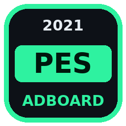

# ⚽ PES 2021 Adboard Studio

Aplikasi Windows (`.exe`) untuk **melihat, mengedit, dan membuat adboard PES 2021**:
video LED **`.usm`** (CRI Sofdec2) dan tekstur **`.dds`** / gambar biasa.



## ✨ Fitur

| Fitur | Keterangan |
|---|---|
| 📂 **Baca satu folder sekaligus** | Memindai folder (beserta subfolder) dan mencari `.usm`, `.dds`, `.png`, `.jpg`, `.tga`, `.bmp`, `.webp`, serta `.ftex` (hanya ditampilkan) |
| 🖼 **Galeri thumbnail** | Thumbnail frame pertama untuk setiap USM/DDS, filter per tipe, pencarian, ukuran thumbnail bisa diatur, pohon folder di kiri |
| 🎬 **Player USM** | Play/pause, seek per frame, loop, kecepatan 0.25x–2x, zoom/pan, tampilan channel RGBA/RGB/Alpha |
| 🏟 **Simulasi stadion** | Adboard (termasuk animasinya) ditampilkan di pinggir lapangan: kamera broadcast atau close-up, mode malam (LED) atau siang |
| ⚡ **Ganti adboard** | Tarik & lepas gambar, video (mp4/mkv/avi/mov/webm/gif) atau USM lain. Ada preview **sebelum/sesudah**, dan mode Stretch, Fit atau Fill |
| 🎯 **Otomatis sama dengan file asli** | Resolusi, FPS, codec (MPEG-1/2, H.264, VP9) dan struktur header USM diambil dari file asli, supaya hasilnya cocok dengan game |
| 📦 **Batch** | Pilih banyak adboard sekaligus (Ctrl/Shift+klik), lalu ganti semuanya dengan satu sumber. Setiap file tetap mengikuti resolusinya sendiri |
| 💡 **Generator teks LED** | Teks berjalan ke kiri/kanan, kedip, statis, atau ganti-ganti teks. Ada efek titik LED dot-matrix, glow, outline, gradasi warna dan loop mulus. Hasilnya bisa disimpan ke USM atau DDS |
| 📤 **Export** | USM ke MP4, PNG, semua frame PNG, atau elementary stream mentah. DDS ke PNG, TGA atau JPG |
| 🕘 **Backup & restore** | Setiap kali menimpa, file asli otomatis dicadangkan ke folder `_adboard_backup` dan bisa dikembalikan kapan saja |
| 🧊 **DDS** | Menulis DXT1, DXT3, DXT5 atau RGBA beserta mipmap. Format asli dipertahankan secara otomatis |

## 📥 Download `.exe`

File `.exe` dibangun otomatis oleh GitHub Actions (workflow **Build EXE**) di Windows:

1. Buka tab **Actions**, lalu pilih run **Build EXE** terbaru yang berhasil (✅).
2. Download artifact **PES2021_Adboard_Studio** (isinya `PES2021_Adboard_Studio.exe`).
3. Jalankan. Tidak perlu install apa pun karena ffmpeg sudah ikut di dalam exe.

Kalau dibuat tag `v1.0.0`, file exe juga otomatis dilampirkan di halaman **Releases**.

### Build sendiri di Windows

```bat
build.bat
```

Hasilnya ada di `dist\PES2021_Adboard_Studio.exe`. Build ini butuh Python 3.10 atau lebih baru.

Untuk menjalankan langsung dari source tanpa build:

```bash
pip install -r requirements.txt
python main.py "D:\PES 2021\adboard"
```

## 🕹 Cara pakai

1. **📂 Buka Folder**: pilih folder adboard (misalnya hasil ekstrak CPK atau folder mod), atau tarik foldernya ke jendela aplikasi.
2. Klik file di galeri untuk melihatnya di tab **Preview**, **Simulasi Stadion**, atau **Info** (codec, resolusi, fps, jumlah frame, durasi, stream).
3. **⚡ Ganti** (atau double-click file): tarik gambar/video sumber, atur mode ukuran, durasi, dan kualitas, lalu klik **Terapkan**.
   - Bisa juga dengan menarik file sumber langsung ke panel preview.
4. **💡 Teks LED**: ketik teks (pisahkan dengan `|` untuk mode ganti-ganti), atur warna dan efek, lalu **Ganti** file terpilih atau simpan sebagai USM/DDS baru.
5. Masukkan kembali file ke game seperti biasa (misalnya lewat CPK atau sider).

Shortcut: `Ctrl+O` buka folder, `F5` refresh, `Ctrl+R` ganti, `Ctrl+L` teks LED, `Ctrl+E` export, `Ctrl+B` backup.

## ⚠ Catatan

- **Codec**: pilihan default **Auto** memakai codec yang sama dengan USM asli. Ini disarankan, karena game hanya bisa memutar codec yang didukungnya.
- **USM terenkripsi**: kalau stream video tidak bisa dikenali (misalnya dienkripsi dengan key), preview tidak tersedia. Header dan info tetap bisa dibaca.
- **FTEX** (`.ftex`/`.ftexs`) hanya ditampilkan di daftar. Konversi dulu ke DDS (misalnya dengan FtexTool), edit, lalu konversi balik.
- Audio di dalam USM tidak disertakan saat file diganti, karena adboard tidak memakai suara.
- Selalu tes hasilnya di game. Kalau ada masalah, pulihkan file asli lewat **🕘 Backup/Restore**.

## 🧩 Struktur kode

```
main.py                     entry point
pes_adboard/
  utf_table.py              reader/writer tabel CRI @UTF
  usm.py                    parser, demuxer & muxer USM (MPEG-1/2, H.264, VP9)
  media.py                  helper ffmpeg (decode preview, encode)
  textures.py               DDS (DXT1/3/5/RGBA + mipmap), gambar
  library.py                scan folder, thumbnail, replace, backup, export
  gui/                      antarmuka PySide6 (galeri, player, stadion, dialog)
tests/test_core.py          tes mux/demux untuk semua codec, DDS, dan replace end-to-end
```

Tes: `python -m pytest -q`
